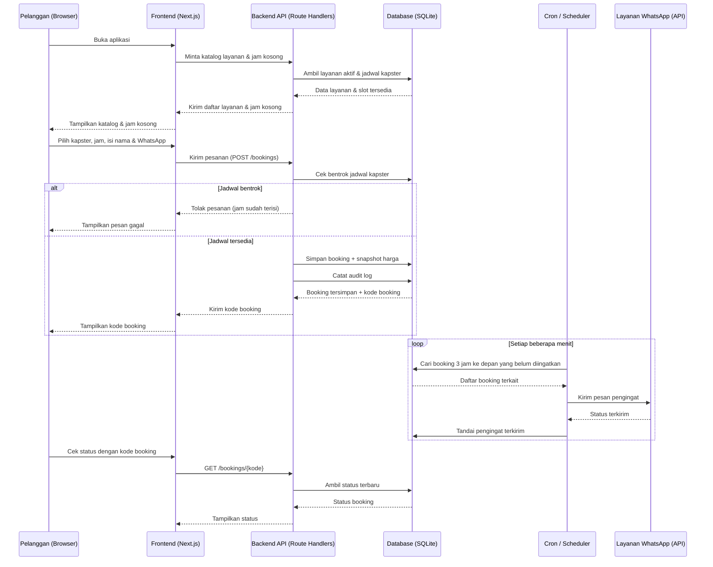
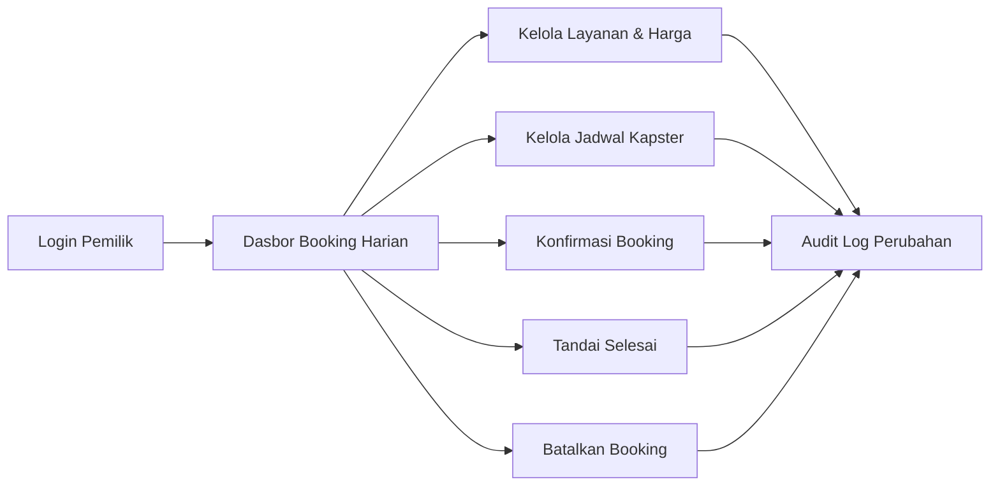
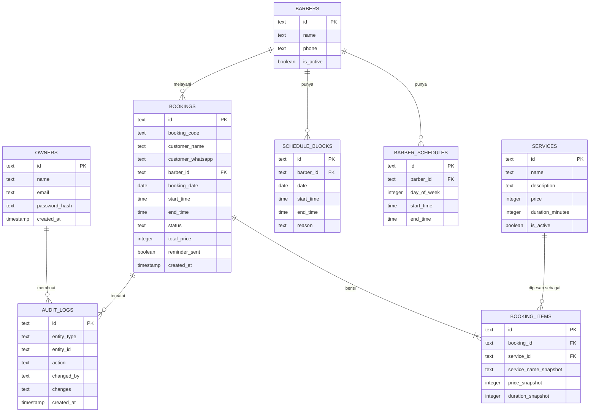

# PRD — Project Requirements Document

## 1. Overview

### Masalah yang Diselesaikan
Pelanggan salon dan barbershop sering harus datang lebih awal hanya untuk mengantre, bertanya ketersediaan kapster, atau menunggu tanpa kepastian. Di sisi lain, pemilik salon kesulitan mengatur jadwal kapster, harga layanan yang berubah-ubah, dan status booking secara rapi — sering kali masih dicatat manual di buku atau chat WhatsApp yang berserakan.

### Tujuan Utama
Membangun aplikasi booking salon dan barbershop yang memungkinkan pelanggan:
- **Tidak perlu antre** — cukup pilih kapster dan jam kosong dari mana saja.
- **Booking tanpa akun** — hanya perlu nama dan nomor WhatsApp.
- **Dapat pengingat otomatis** 3 jam sebelum jadwal agar tidak lupa datang.

Dan memungkinkan pemilik salon:
- Mengelola layanan, harga, jadwal kapster, dan status booking dengan mudah.
- Memastikan satu kapster tidak menerima dua booking di jam yang sama.
- Memiliki catatan lengkap atas setiap perubahan (siapa dan kapan).

Pembayaran tetap dilakukan **langsung di salon**, sehingga aplikasi fokus pada pemesanan dan pengingat, bukan transaksi online.

---

## 2. Requirements

### Persyaratan Fungsional
1. Pelanggan dapat melihat katalog layanan lengkap dengan **harga dan durasi**.
2. Pelanggan dapat melihat **jam kosong** per kapster dan per tanggal.
3. Pelanggan dapat memesan **tanpa membuat akun** (cukup nama + nomor WhatsApp).
4. Sistem memberikan **kode booking** yang bisa dipakai pelanggan untuk cek status.
5. Sistem mengirim **pengingat 3 jam sebelum jadwal** ke nomor WhatsApp pelanggan.
6. Pemilik dapat **login** dan mengelola salon dari satu dasbor.
7. Pemilik dapat mengelola **layanan, harga, dan durasi**.
8. Pemilik dapat mengelola **jadwal kerja kapster** dan menutup jam tertentu (istirahat/cuti).
9. Pemilik dapat mengubah **status booking**: dikonfirmasi, selesai, batal.
10. Sistem **mencegah jadwal bentrok** (satu kapster tidak bisa dobel di jam yang sama).
11. Setiap perubahan (harga, jadwal, status) **tercatat siapa dan kapan** (audit log).
12. Booking lama tetap menampilkan **harga yang berlaku saat dipesan**, meski harga layanan berubah.

### Persyaratan Non-Fungsional
- **Mudah dipakai**: alur pemesanan maksimal 3–4 langkah.
- **Cepat**: halaman katalog dan jadwal terbuka di bawah 2 detik pada koneksi seluler standar.
- **Mobile-first**: mayoritas pelanggan memakai ponsel.
- **Aman**: hanya pemilik terautentikasi yang bisa mengubah data salon.
- **Andal**: pengingat terkirim tepat waktu (toleransi ±5 menit).
- **Auditable**: riwayat perubahan tidak bisa dihapus sembarangan.

---

## 3. Core Features

Fitur disusun mengikuti fase roadmap yang sudah disetujui.

### Fase 1 — Fondasi Pemilihan (Kemenangan Pertama)
- **Pilih Kapster & Jam**
  - **Lihat Jam Kosong** — pelanggan melihat daftar jam yang masih tersedia untuk kapster dan tanggal yang dipilih.
  - **Pilih Kapster** — pelanggan memilih kapster favorit atau yang jamnya paling cocok.
  - **Ringkasan Pilihan** — pelanggan langsung melihat harga dan durasi dari pilihan sebelum lanjut memesan.
- **Katalog Layanan**
  - **Daftar Layanan & Harga** — semua layanan tampil lengkap dengan harga dan durasi dalam satu tampilan.
  - **Detail Layanan** — penjelasan singkat tiap layanan sebelum pelanggan memutuskan.
  - **Cari Layanan** — pelanggan bisa mencari layanan tertentu tanpa menggulir seluruh daftar.

### Fase 2 — Pemesanan Tanpa Hambatan
- **Booking Tanpa Akun**
  - **Isi Nama & WhatsApp** — data pemesanan cukup nama dan nomor WhatsApp.
  - **Konfirmasi Pesanan** — pelanggan meninjau ulang layanan, kapster, jam, dan harga sebelum memesan.
  - **Kode Booking & Cek Status** — pelanggan menerima kode booking dan bisa memakainya untuk melihat status pesanan.

### Fase 3 — Pengelolaan oleh Pemilik
- **Kelola Status Booking**
  - **Daftar Booking Harian** — semua booking hari ini beserta jam dan kapsterya dalam satu layar.
  - **Konfirmasi & Selesai** — pemilik menandai booking sebagai dikonfirmasi atau selesai.
  - **Batalkan Booking** — pemilik membatalkan booking yang tidak bisa dijalankan.
  - **Catatan Perubahan** — setiap perubahan status tercatat siapa yang mengubah dan kapan.
- **Kelola Layanan & Harga**
  - **Tambah & Ubah Layanan** — menambah layanan baru atau mengubah nama dan durasinya.
  - **Atur Harga** — menetapkan dan memperbarui harga tiap layanan.
  - **Nonaktifkan Layanan** — layanan yang tidak dijual lagi disembunyikan dari pelanggan tanpa menghapus riwayatnya.
  - **Harga Lama Tetap Tersimpan** — booking lama tetap menampilkan harga yang berlaku saat dipesan.
- **Kelola Jadwal Kapster**
  - **Jam Kerja Kapster** — mengatur hari dan jam kerja tiap kapster.
  - **Tutup Jam Tertentu** — menutup jam istirahat atau cuti agar tidak bisa dipesan.
  - **Cegah Jadwal Bentrok** — satu kapster tidak bisa menerima dua booking di jam yang sama.

### Fase 4 — Pengingat & Autentikasi Pemilik
- **Pengingat Sebelum Jadwal**
  - **Pengingat 3 Jam Sebelum** — sistem mengirim pengingat otomatis 3 jam sebelum jam booking.
  - **Kirim ke WhatsApp** — pengingat dikirim ke nomor WhatsApp yang diisi saat memesan.
  - **Status Pengingat** — pemilik bisa melihat pengingat mana yang sudah terkirim.
- **Masuk Pemilik**
  - **Login Pemilik** — masuk memakai akun pemilik untuk membuka halaman pengelolaan.
  - **Keluar Akun** — bisa keluar dengan aman dari perangkat yang dipakai bersama.
  - **Lupa Kata Sandi** — memulihkan akses akun sendiri tanpa bantuan teknis.

---

## 3.1 Fitur Pendukung Lintas Fase
- **Audit Log Perubahan** — setiap perubahan harga, jadwal, dan status booking mencatat pelaku dan waktu.
- **Snapshot Harga Booking** — harga pada booking disimpan terpisah dari harga master layanan.

---

## 4. User Flow

### A. Alur Pelanggan (Fase 1 → Fase 2)

1. **Buka aplikasi** — pelanggan membuka tautan aplikasi salon di ponsel.
2. **Lihat katalog** — pelanggan melihat daftar layanan, harga, dan durasi.
3. **Cari layanan (opsional)** — pelanggan mengetik nama layanan untuk mempersempit pilihan.
4. **Pilih layanan** — pelanggan memilih satu atau beberapa layanan yang diinginkan.
5. **Pilih kapster** — pelanggan memilih kapster yang diinginkan.
6. **Pilih tanggal & jam** — sistem menampilkan jam kosong; pelanggan memilih satu jam.
7. **Lihat ringkasan** — pelanggan melihat layanan, kapster, jam, harga, dan durasi.
8. **Isi data pemesanan** — pelanggan mengisi nama dan nomor WhatsApp (tanpa akun).
9. **Konfirmasi pesanan** — pelanggan menekan tombol pesan.
10. **Terima kode booking** — sistem menampilkan kode booking dan ringkasan pesanan.
11. **Cek status (kapan saja)** — pelanggan memasukkan kode booking untuk melihat status terbaru.
12. **Terima pengingat** — 3 jam sebelum jadwal, pelanggan menerima pesan WhatsApp.
13. **Datang & bayar di salon** — pelanggan menyelesaikan pembayaran langsung di salon.

### B. Alur Pemilik Salon (Fase 3 → Fase 4)

1. **Login** — pemilik masuk dengan email/kata sandi.
2. **Lihat dasbor harian** — pemilik melihat semua booking hari ini beserta jam dan kapsterya.
3. **Konfirmasi booking** — pemilik menandai booking yang sudah dikonfirmasi.
4. **Tandai selesai** — setelah pelanggan selesai, pemilik menandai booking sebagai selesai.
5. **Batalkan bila perlu** — pemilik membatalkan booking yang tidak bisa dijalankan, dengan catatan.
6. **Kelola layanan & harga** — pemilik menambah, mengubah, atau menonaktifkan layanan serta menetapkan harga.
7. **Kelola jadwal kapster** — pemilik mengatur jam kerja, menutup jam istirahat/cuti.
8. **Pantau pengingat** — pemilik melihat pengingat mana yang sudah terkirim.
9. **Logout** — pemilik keluar dengan aman setelah selesai.

---

## 5. Architecture

Aplikasi ini menggunakan arsitektur **full-stack terpadu**: frontend dan backend berada dalam satu basis kode, dengan database SQLite sebagai penyimpanan utama. Pengingat WhatsApp dikirim oleh **penjadwal (cron job)** yang memeriksa booking mendatang dan memanggil layanan pesan.

**Alur Pemilik (sederhana):**

---

## 6. Database Schema

### Tabel Utama

**owners** — akun pemilik salon
- `id` (text, PK) — identitas unik pemilik
- `name` (text) — nama pemilik
- `email` (text, unique) — email untuk login
- `password_hash` (text) — kata sandi terenkripsi
- `reset_token` (text, nullable) — token untuk lupa kata sandi
- `reset_token_expires` (timestamp, nullable) — masa berlaku token
- `created_at` (timestamp) — waktu dibuat

**barbers** (kapster) — daftar kapster salon
- `id` (text, PK)
- `name` (text) — nama kapster
- `phone` (text, nullable) — kontak kapster
- `is_active` (boolean) — aktif atau tidak
- `created_at` (timestamp)

**services** (layanan) — layanan yang ditawarkan
- `id` (text, PK)
- `name` (text) — nama layanan
- `description` (text) — penjelasan singkat
- `price` (integer) — harga aktif (dalam rupiah)
- `duration_minutes` (integer) — durasi layanan (menit)
- `is_active` (boolean) — bila nonaktif, disembunyikan dari pelanggan
- `created_at` (timestamp)
- `updated_at` (timestamp)

**barber_schedules** — jam kerja kapster per hari
- `id` (text, PK)
- `barber_id` (text, FK → barbers.id)
- `day_of_week` (integer) — 0=Minggu … 6=Sabtu
- `start_time` (time) — jam mulai kerja
- `end_time` (time) — jam selesai kerja

**schedule_blocks** — jam yang ditutup (istirahat/cuti)
- `id` (text, PK)
- `barber_id` (text, FK → barbers.id)
- `date` (date) — tanggal blokir
- `start_time` (time)
- `end_time` (time)
- `reason` (text, nullable) — alasan (mis. istirahat, cuti)

**bookings** — pesanan pelanggan
- `id` (text, PK)
- `booking_code` (text, unique) — kode booking untuk pelanggan
- `customer_name` (text) — nama pelanggan
- `customer_whatsapp` (text) — nomor WhatsApp pelanggan
- `barber_id` (text, FK → barbers.id)
- `booking_date` (date) — tanggal booking
- `start_time` (time) — jam mulai
- `end_time` (time) — jam selesai
- `status` (text) — `pending`, `confirmed`, `completed`, `cancelled`
- `total_price` (integer) — total harga snapshot saat dipesan
- `total_duration` (integer) — total durasi (menit)
- `reminder_sent` (boolean) — apakah pengingat sudah dikirim
- `created_at` (timestamp)
- `updated_at` (timestamp)

**booking_items** — rincian layanan dalam satu booking
- `id` (text, PK)
- `booking_id` (text, FK → bookings.id)
- `service_id` (text, FK → services.id)
- `service_name_snapshot` (text) — nama layanan saat dipesan
- `price_snapshot` (integer) — harga saat dipesan (agar harga lama tetap tersimpan)
- `duration_snapshot` (integer) — durasi saat dipesan

**audit_logs** — catatan perubahan data
- `id` (text, PK)
- `entity_type` (text) — mis. `booking`, `service`, `schedule`
- `entity_id` (text) — id entitas yang diubah
- `action` (text) — mis. `create`, `update`, `cancel`, `complete`
- `changed_by` (text) — id pemilik yang melakukan perubahan
- `changes` (text/JSON) — detail perubahan (nilai lama → baru)
- `created_at` (timestamp) — waktu perubahan

### Diagram ER

---

## 7. Tech Stack

Karena tech stack belum ditentukan, berikut rekomendasi default yang cocok untuk aplikasi full-stack ini:

| Lapisan | Teknologi | Alasan |
|---|---|---|
| **Frontend** | Next.js (App Router) + React | Satu framework untuk tampilan pelanggan & dasbor pemilik; dukungan server-side rendering agar cepat di ponsel. |
| **Styling** | Tailwind CSS | Cepat membangun antarmuka yang rapi dan responsif. |
| **Komponen UI** | shadcn/ui | Komponen siap pakai, konsisten, mudah disesuaikan. |
| **Backend** | Next.js API Route Handlers | Satu basis kode untuk frontend dan backend, mempermudah pemeliharaan. |
| **Database** | SQLite | Ringan, tanpa server terpisah, cocok untuk skala salon kecil–menengah. |
| **ORM** | Drizzle ORM | Tipe data aman, mudah dibaca, dan ringan. |
| **Autentikasi** | Better Auth | Menangani login pemilik, logout, dan lupa kata sandi dengan aman. |
| **Pengingat WhatsApp** | WhatsApp Business API / penyedia pihak ketiga (mis. Fonnte, Wablas) | Mengirim pesan otomatis ke nomor pelanggan. |
| **Penjadwal** | Cron job (mis. Vercel Cron / node-cron) | Memeriksa dan mengirim pengingat 3 jam sebelum jadwal. |
| **Deployment** | Vercel | Mudah, cepat, dan terintegrasi dengan Next.js. |

**Catatan implementasi penting:**
- **Cegah jadwal bentrok** dilakukan dengan memeriksa ketersediaan slot sebelum menyimpan booking (validasi di backend + batasan unik pada kombinasi kapster + tanggal + jam).
- **Snapshot harga** disimpan di `booking_items` sehingga perubahan harga layanan tidak mengubah riwayat booking lama.
- **Audit log** dicatat otomatis setiap ada perubahan pada layanan, jadwal, atau status booking.