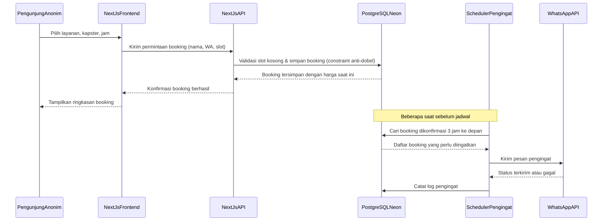
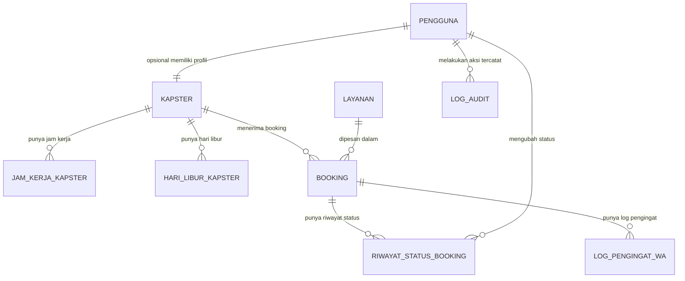

# PRD — Project Requirements Document

## 1. Overview

BookKapster adalah aplikasi booking online untuk salon dan barbershop, tempat pelanggan bisa lihat layanan, harga, dan jadwal kapster yang kosong, lalu booking sendiri tanpa perlu daftar akun.

**Latar Belakang & Masalah**

Pak Dedi punya barbershop kecil dengan 3 kapster. Selama ini pelanggan booking lewat chat WhatsApp manual ke kasir, kadang balasnya lama karena kasir sibuk, dan beberapa kali satu kapster kebagian dua jadwal di jam yang sama karena kasir lupa catat. Pelanggan yang datang langsung tanpa booking juga sering harus menunggu lama di tempat. Pak Dedi ingin pelanggan bisa lihat sendiri jadwal kosong dan booking langsung tanpa ribet, sementara ia tetap bisa pantau dan atur semuanya dari sisi toko.

**Tujuan Utama**

1. Memudahkan pelanggan booking layanan salon/barbershop tanpa perlu membuat akun
2. Mencegah bentrok jadwal (dobel booking) pada kapster yang sama
3. Memberi pemilik salon alat untuk mengelola layanan, harga, jadwal kapster, dan status booking
4. Mengurangi pelanggan yang lupa datang lewat pengingat otomatis via WhatsApp
5. Menjaga riwayat booking tetap akurat meski harga layanan berubah

**Prinsip Utama**

- Pelanggan tidak boleh diwajibkan membuat akun untuk booking
- Satu kapster tidak boleh memiliki dua booking pada jam yang sama (validasi harus otomatis, bukan manual)
- Harga yang tersimpan di riwayat booking harus harga saat booking dibuat, bukan harga terbaru
- Setiap perubahan data penting (harga, jadwal, status booking) oleh admin wajib tercatat siapa dan kapan
- Pembayaran dilakukan di salon, aplikasi tidak memproses pembayaran online

**Sukses seperti apa yang diharapkan**

Produk ini berhasil jika pelanggan bisa melihat jadwal kosong dan menyelesaikan booking sendiri tanpa akun dalam waktu singkat, tidak ada lagi kasus kapster dobel booking, dan pemilik salon bisa mengelola layanan, jadwal, serta status booking dengan jejak perubahan yang jelas.

---

## 2. Requirements

### 2.1 Persyaratan Fungsional

- **FR-01** — pengunjung anonim dapat mengisi nama dan nomor WhatsApp untuk membuat booking tanpa perlu login atau mendaftar akun _(Fitur: Booking Tanpa Akun)_
- **FR-02** — pengunjung anonim dapat memilih layanan, kapster, dan jam kosong yang tersedia sebelum menyelesaikan booking _(Fitur: Booking Tanpa Akun)_
- **FR-03** — Sistem menampilkan konfirmasi instan (di layar) setelah booking berhasil disimpan, mencakup ringkasan layanan, kapster, jam, dan harga _(Fitur: Booking Tanpa Akun)_
- **FR-04** — pengunjung anonim dan pelanggan dapat melihat daftar layanan beserta harga dan durasinya sebelum memilih _(Fitur: Booking Tanpa Akun)_
- **FR-05** — Sistem menampilkan hanya slot jam yang masih kosong untuk kapster terpilih berdasarkan jam kerja, hari libur, dan booking yang sudah ada _(Fitur: Jadwal Anti-Dobel)_
- **FR-06** — Sistem mengunci (menyembunyikan atau menonaktifkan) slot jam yang sudah terisi booking lain agar tidak bisa dipilih ulang _(Fitur: Jadwal Anti-Dobel)_
- **FR-07** — Sistem melakukan validasi otomatis saat booking disimpan untuk menolak booking yang bertabrakan jam dengan booking lain pada kapster yang sama, meski dua permintaan datang hampir bersamaan _(Fitur: Jadwal Anti-Dobel)_
- **FR-08** — admin dapat menambah, mengubah, dan menghapus data layanan termasuk nama, harga, dan durasi _(Fitur: Kelola Layanan & Harga)_
- **FR-09** — Sistem menyimpan harga layanan yang berlaku pada saat booking dibuat ke dalam data booking, terpisah dari harga layanan yang sedang berjalan, sehingga perubahan harga layanan di kemudian hari tidak mengubah riwayat booking lama _(Fitur: Kelola Layanan & Harga)_
- **FR-10** — admin dapat menandai status booking menjadi dikonfirmasi, selesai, atau batal _(Fitur: Kelola Status Booking)_
- **FR-11** — admin dapat melihat daftar booking harian beserta nama pelanggan, nomor WhatsApp, layanan, kapster, jam, dan status _(Fitur: Kelola Status Booking)_
- **FR-12** — Sistem mencatat admin mana yang mengubah status booking dan kapan perubahan itu terjadi _(Fitur: Kelola Status Booking)_
- **FR-13** — admin dapat mengatur jam kerja masing-masing kapster per hari _(Fitur: Jadwal Kapster)_
- **FR-14** — admin dapat menandai tanggal libur kapster sehingga tanggal tersebut tidak muncul sebagai slot yang bisa dibooking _(Fitur: Jadwal Kapster)_
- **FR-15** — admin dapat melihat kalender booking per kapster untuk memantau jadwalnya _(Fitur: Jadwal Kapster)_
- **FR-16** — Sistem mengirim pesan pengingat otomatis via WhatsApp kepada pelanggan 3 jam sebelum jadwal booking yang berstatus dikonfirmasi _(Fitur: Pengingat Otomatis WA)_
- **FR-17** — Sistem menggunakan template pesan otomatis untuk pengingat WhatsApp yang mencantumkan layanan, kapster, dan jam booking _(Fitur: Pengingat Otomatis WA)_
- **FR-18** — Sistem mencatat log setiap pengingat yang terkirim, termasuk status terkirim atau gagal _(Fitur: Pengingat Otomatis WA)_
- **FR-19** — Sistem mencatat admin yang melakukan perubahan harga layanan atau jadwal kapster beserta waktu perubahannya _(Fitur: Jejak Perubahan)_
- **FR-20** — admin dapat melihat riwayat perubahan status booking berupa status sebelum dan sesudah, siapa yang mengubah, dan kapan _(Fitur: Jejak Perubahan)_
- **FR-21** — admin dapat melihat ringkasan jumlah booking harian pada dashboard _(Fitur: Dashboard Pemilik)_
- **FR-22** — admin dapat melihat jumlah booking per kapster dalam rentang tanggal tertentu _(Fitur: Dashboard Pemilik)_
- **FR-23** — admin dapat melihat estimasi pendapatan dihitung dari harga booking yang berstatus selesai _(Fitur: Dashboard Pemilik)_
- **FR-24** — pelanggan dapat mencari kapster dengan slot kosong tercepat berdasarkan layanan yang dipilih _(Fitur: Pencarian Jadwal)_
- **FR-25** — pelanggan dapat memfilter pencarian jadwal berdasarkan layanan tertentu _(Fitur: Pencarian Jadwal)_
- **FR-26** — pelanggan dapat memfilter pencarian jadwal berdasarkan tanggal tertentu _(Fitur: Pencarian Jadwal)_
- **FR-27** — pelanggan dapat melihat histori booking miliknya berdasarkan nomor WhatsApp yang pernah digunakan _(Fitur: Riwayat Pelanggan)_
- **FR-28** — pelanggan dapat membuat booking baru dengan menyalin layanan dan kapster dari booking favorit sebelumnya _(Fitur: Riwayat Pelanggan)_

### 2.2 Persyaratan Non-Fungsional

- **NFR-01** — Proses booking dari pemilihan layanan sampai konfirmasi berhasil dapat diselesaikan tanpa reload halaman penuh dan merespons dalam waktu kurang dari 3 detik pada koneksi normal
- **NFR-02** — Validasi anti-dobel booking harus konsisten di level database (constraint atau transaction lock), bukan hanya validasi di sisi tampilan, untuk mencegah race condition saat dua booking masuk bersamaan
- **NFR-03** — Setiap pencatatan jejak perubahan (harga, jadwal, status booking) wajib menyimpan id pengubah, peran pengubah, nilai sebelum, nilai sesudah, dan waktu perubahan
- **NFR-04** — Formulir booking publik dan pencarian jadwal dibatasi lajunya (rate limit) untuk mencegah spam booking otomatis dari satu sumber dalam rentang waktu singkat
- **NFR-05** — Pengiriman pengingat WhatsApp dijalankan melalui proses terjadwal (scheduler) yang cocok dengan lingkungan serverless, dengan mekanisme pencatatan agar tidak ada pengingat yang terkirim dobel untuk booking yang sama
- **NFR-06** — Tampilan aplikasi responsif dan dapat digunakan dengan baik pada lebar layar mulai dari ukuran ponsel hingga desktop
- **NFR-07** — Data booking, layanan, dan jadwal kapster disimpan di database PostgreSQL dan dapat dipulihkan dari backup rutin sesuai persyaratan penyedia layanan database

### 2.3 Di Luar Cakupan (untuk versi ini)

- Pembayaran online di dalam aplikasi (pembayaran tetap dilakukan langsung di salon)
- Login atau akun untuk pelanggan di Fase 1-3

### 2.4 Pertanyaan Terbuka

- **OQ-01** — Siapa penyedia API WhatsApp yang akan dipakai untuk mengirim pengingat otomatis (misalnya WhatsApp Business API resmi atau penyedia pihak ketiga), karena ini memengaruhi biaya dan cara integrasi?
- **OQ-02** — Apakah nomor WhatsApp pelanggan dianggap sebagai identitas unik untuk fitur Riwayat Pelanggan di Fase 4, atau perlu verifikasi tambahan agar tidak disalahgunakan orang lain yang tahu nomor tersebut?
- **OQ-03** — Berapa batas wajar jumlah booking yang boleh dibuat dari satu nomor WhatsApp atau satu sumber dalam rentang waktu tertentu untuk keperluan rate limit di NFR-04?
- **OQ-04** — Jika pengingat WhatsApp gagal terkirim (misal nomor tidak valid), apakah perlu ada notifikasi balik ke admin agar bisa menghubungi pelanggan lewat cara lain?

### 2.5 Catatan Tambahan Pengguna yang Diterapkan

| Aturan dari catatan | Dipenuhi oleh |
|---|---|
| Harga layanan bisa berubah, tetapi riwayat booking lama tetap menampilkan harga saat dipesan | FR-09 |
| Setiap perubahan oleh pemilik (harga, jadwal, status booking) harus tercatat siapa yang mengubah dan kapan | FR-12, FR-19, FR-20, NFR-03 |
| Satu kapster tidak boleh punya dua booking di jam yang sama | FR-05, FR-06, FR-07, NFR-02 |
| Pengingat dikirim 3 jam sebelum jadwal | FR-16, NFR-05 |

---

## 3. Core Features

*(Disusun sesuai peta fitur yang telah disetujui, mengikuti urutan fase.)*

### Fase 1 — Booking Tanpa Akun

Memudahkan pelanggan membuat booking sendiri tanpa perlu daftar akun, cukup dengan nama dan nomor WhatsApp

- **Isi nama & nomor WhatsApp** — Pelanggan mengisi nama dan nomor WhatsApp sebagai identitas booking tanpa proses pendaftaran akun
- **Pilih layanan, kapster, jam kosong** — Pelanggan memilih layanan, kapster, dan jam kosong yang tersedia dalam satu alur booking
- **Konfirmasi booking instan** — Sistem menampilkan konfirmasi instan di layar begitu booking berhasil disimpan
- **Lihat harga & durasi layanan** — Pelanggan dapat melihat harga dan durasi tiap layanan sebelum memutuskan memilih

### Fase 1 — Jadwal Anti-Dobel

Mencegah satu kapster kebagian dua booking di jam yang sama sehingga jadwal selalu akurat

- **Cek slot kosong per kapster** — Sistem menampilkan hanya slot jam yang benar-benar kosong untuk kapster yang dipilih
- **Kunci jam yang sudah terisi** — Slot jam yang sudah terisi booking lain otomatis terkunci dan tidak bisa dipilih lagi
- **Validasi otomatis saat booking** — Sistem memvalidasi otomatis saat booking disimpan agar tidak ada dua booking bertabrakan jam pada kapster yang sama

### Fase 1 — Kelola Layanan & Harga

Memberi admin kendali penuh atas daftar layanan dan harga tanpa mengganggu riwayat booking lama

- **Tambah/ubah/hapus layanan** — Admin dapat menambah, mengubah, atau menghapus layanan beserta detailnya
- **Atur harga & durasi** — Admin dapat mengatur harga dan durasi masing-masing layanan
- **Riwayat booking pakai harga lama** — Riwayat booking lama tetap menampilkan harga yang berlaku saat booking itu dibuat, meski harga layanan berubah kemudian

### Fase 1 — Kelola Status Booking

Membantu admin memantau dan mengelola status setiap booking harian secara tertib

- **Tandai dikonfirmasi, selesai, batal** — Admin dapat menandai booking sebagai dikonfirmasi, selesai, atau batal
- **Lihat daftar booking harian** — Admin dapat melihat daftar booking harian lengkap dengan data pelanggan dan layanan
- **Catatan siapa & kapan ubah status** — Sistem mencatat siapa admin yang mengubah status booking dan kapan perubahan itu terjadi

### Fase 1 — Jadwal Kapster

Memastikan jam kerja dan hari libur tiap kapster tercatat rapi sehingga jadwal booking selalu sesuai kenyataan

- **Atur jam kerja tiap kapster** — Admin dapat mengatur jam kerja masing-masing kapster per hari
- **Blokir tanggal libur** — Admin dapat menandai tanggal libur kapster agar tidak muncul sebagai slot booking
- **Lihat kalender per kapster** — Admin dapat melihat kalender booking per kapster untuk memantau jadwalnya

### Fase 2 — Pengingat Otomatis WA

Mengurangi pelanggan lupa jadwal dengan pengingat otomatis lewat WhatsApp

- **Kirim pengingat 3 jam sebelum** — Sistem mengirim pesan pengingat otomatis 3 jam sebelum jadwal booking yang dikonfirmasi
- **Pesan otomatis via WhatsApp** — Pesan pengingat menggunakan template otomatis yang mencantumkan layanan, kapster, dan jam booking
- **Log pengingat terkirim** — Sistem mencatat log setiap pengingat yang terkirim beserta status berhasil atau gagal

### Fase 2 — Jejak Perubahan

Memberi transparansi dan akuntabilitas atas setiap perubahan data penting yang dilakukan admin

- **Catat siapa ubah harga/jadwal** — Sistem mencatat admin yang mengubah harga layanan atau jadwal kapster beserta waktu perubahannya
- **Catat waktu perubahan** — Sistem mencatat waktu setiap perubahan data secara otomatis
- **Riwayat perubahan status booking** — Admin dapat melihat riwayat perubahan status booking beserta status sebelum dan sesudahnya

### Fase 3 — Dashboard Pemilik

Memberi pemilik gambaran cepat performa salon lewat satu halaman ringkas

- **Ringkasan booking harian** — Admin dapat melihat ringkasan jumlah booking harian
- **Jumlah booking per kapster** — Admin dapat melihat jumlah booking per kapster dalam rentang tanggal tertentu
- **Pendapatan estimasi dari booking** — Admin dapat melihat estimasi pendapatan dari booking yang berstatus selesai

### Fase 3 — Pencarian Jadwal

Membantu pelanggan menemukan kapster dengan jadwal kosong tercepat sesuai kebutuhan

- **Cari kapster tersedia tercepat** — Pelanggan dapat mencari kapster dengan slot kosong tercepat berdasarkan layanan yang dipilih
- **Filter berdasarkan layanan** — Pelanggan dapat memfilter pencarian jadwal berdasarkan layanan tertentu
- **Filter berdasarkan tanggal** — Pelanggan dapat memfilter pencarian jadwal berdasarkan tanggal tertentu

### Fase 4 — Riwayat Pelanggan

Memudahkan pelanggan setia booking ulang layanan favoritnya tanpa mengisi ulang dari awal

- **Lihat histori booking by nomor WA** — Pelanggan dapat melihat histori booking miliknya berdasarkan nomor WhatsApp yang pernah digunakan
- **Booking ulang layanan favorit** — Pelanggan dapat membuat booking baru dengan menyalin layanan dan kapster dari booking favorit sebelumnya

---

## 4. User Flow

**1) Pelanggan membuat booking tanpa akun (Fase 1)**
Pelanggan membuka halaman booking → Pelanggan melihat daftar layanan beserta harga dan durasi → Pelanggan memilih layanan dan kapster → Sistem menampilkan slot jam kosong kapster tersebut → Pelanggan memilih jam → Pelanggan mengisi nama dan nomor WhatsApp → Sistem memvalidasi slot masih kosong lalu menyimpan booking → Sistem menampilkan konfirmasi instan ke pelanggan

**2) Sistem mencegah booking dobel pada kapster yang sama (Fase 1)**
Dua pelanggan memilih kapster dan jam yang sama hampir bersamaan → Masing-masing mengirim permintaan booking → Database memvalidasi slot lewat constraint anti-dobel → Permintaan pertama berhasil disimpan → Permintaan kedua ditolak dengan pesan slot sudah terisi → Sistem meminta pelanggan kedua memilih jam lain

**3) Admin mengelola layanan dan harga (Fase 1)**
Admin login ke panel kelola → Admin membuka menu layanan → Admin menambah atau mengubah nama, harga, dan durasi layanan → Sistem menyimpan perubahan dan mencatat admin serta waktu perubahan → Booking baru memakai harga terbaru sedangkan booking lama tetap menampilkan harga saat dipesan

**4) Admin mengelola status booking harian (Fase 1)**
Admin membuka daftar booking harian → Admin memilih satu booking → Admin mengubah status menjadi dikonfirmasi, selesai, atau batal → Sistem menyimpan status baru beserta id admin dan waktu perubahan → Riwayat perubahan status tersimpan untuk ditelusuri kembali

**5) Admin mengatur jadwal kerja dan libur kapster (Fase 1)**
Admin membuka menu jadwal kapster → Admin mengatur jam kerja per hari untuk kapster tertentu → Admin menandai tanggal libur kapster → Sistem memperbarui slot yang tersedia untuk booking → Admin melihat kalender kapster untuk memastikan jadwal sudah sesuai

**6) Sistem mengirim pengingat otomatis sebelum jadwal (Fase 2)**
Scheduler terjadwal berjalan secara rutin → Sistem mencari booking dikonfirmasi yang jadwalnya 3 jam ke depan → Sistem menyusun pesan pengingat dari template → Sistem mengirim pesan via WhatsApp API ke pelanggan → Sistem mencatat log status terkirim atau gagal untuk booking tersebut

**7) Admin menelusuri jejak perubahan data (Fase 2)**
Admin membuka menu riwayat perubahan → Admin memilih booking atau layanan tertentu → Sistem menampilkan nilai sebelum, nilai sesudah, pengubah, dan waktu perubahan → Admin menggunakan informasi ini untuk audit internal

**8) Admin memantau performa salon lewat dashboard (Fase 3)**
Admin membuka dashboard pemilik → Sistem menampilkan ringkasan booking harian dan jumlah booking per kapster → Admin memilih rentang tanggal untuk melihat data lebih spesifik → Sistem menghitung estimasi pendapatan dari booking berstatus selesai

---

## 5. Architecture

BookKapster dibangun dengan Next.js sebagai frontend dan backend dalam satu basis kode (fullstack, serverless), menggunakan Drizzle ORM untuk mengakses PostgreSQL (Neon) sebagai penyimpanan data utama. Alur booking publik dan panel admin berjalan di atas arsitektur yang sama, dengan validasi anti-dobel booking diterapkan sebagai constraint di level database agar konsisten meski ada permintaan bersamaan. Auth.js menangani sesi login untuk admin dan kapster, sementara pelanggan dan pengunjung anonim mengakses alur booking tanpa autentikasi. Pengingat WhatsApp dijalankan lewat proses terjadwal yang memanggil WhatsApp API pihak ketiga, dan setiap pengiriman dicatat sebagai log agar tidak terkirim dobel.

**Komponen utama:**
- **Next.js App (frontend & API routes):** Menangani tampilan halaman booking publik, panel admin, serta API routes untuk logika booking, kelola layanan, jadwal, dan status
- **Auth.js:** Mengelola autentikasi dan sesi untuk peran admin dan kapster, sementara pengunjung anonim dan pelanggan tidak memerlukan login
- **PostgreSQL (Neon) via Drizzle ORM:** Menyimpan data layanan, kapster, jadwal, booking, riwayat harga, dan jejak perubahan dengan skema yang didefinisikan dalam TypeScript
- **Constraint anti-dobel booking:** Aturan unik di level database pada kombinasi kapster dan slot jam untuk mencegah dua booking bertabrakan meski terjadi permintaan bersamaan
- **Scheduler pengingat:** Proses terjadwal yang cocok untuk lingkungan serverless, berjalan rutin untuk mencari booking yang 3 jam lagi dimulai dan memicu pengiriman pengingat
- **WhatsApp API (pihak ketiga):** Layanan eksternal yang dipanggil sistem untuk mengirim pesan pengingat otomatis ke nomor WhatsApp pelanggan
- **Rate limiter:** Komponen yang membatasi laju permintaan pada formulir booking publik dan pencarian jadwal untuk mitigasi spam dari satu sumber



---

## 6. Database Schema

Semua kolom uang disimpan sebagai integer rupiah (bukan float). Validasi anti-dobel booking diterapkan sebagai constraint unik di level database pada kombinasi kapster_id dan mulai_pada agar konsisten walau ada permintaan bersamaan (lihat NFR-02). Autentikasi hanya untuk admin dan kapster; pengunjung anonim dan pelanggan tidak punya tabel akun di Fase 1-3, sehingga tabel booking mendukung alur tamu lewat nama_tamu dan kontak_tamu.

**pengguna** — Akun login untuk admin dan kapster (dipakai Auth.js). Pelanggan dan pengunjung anonim tidak punya baris di sini.
- `id` (uuid, PK), `nama` (text), `email` (text, unik), `peran` (enum: admin, kapster), `dibuat_pada` (timestamp)

**kapster** — Profil kapster/stylist yang dapat dibooking. Terhubung opsional ke tabel pengguna jika kapster punya akun login untuk lihat kalendernya sendiri.
- `id` (uuid, PK), `pengguna_id` (uuid, FK→pengguna, boleh kosong), `nama` (text), `foto_url` (text, boleh kosong), `aktif` (boolean), `dibuat_pada` (timestamp)

**jam_kerja_kapster** — Jam kerja rutin tiap kapster per hari dalam seminggu.
- `id` (uuid, PK), `kapster_id` (uuid, FK→kapster), `hari_dalam_minggu` (enum: senin, selasa, rabu, kamis, jumat, sabtu, minggu), `jam_mulai` (time), `jam_selesai` (time), `dibuat_pada` (timestamp)

**hari_libur_kapster** — Tanggal-tanggal libur kapster yang membuat tanggal tersebut tidak muncul sebagai slot booking.
- `id` (uuid, PK), `kapster_id` (uuid, FK→kapster), `tanggal` (date), `alasan` (text, boleh kosong), `dibuat_pada` (timestamp)

**layanan** — Daftar layanan salon/barbershop beserta harga dan durasi yang sedang berlaku saat ini.
- `id` (uuid, PK), `nama` (text), `deskripsi` (text, boleh kosong), `harga` (integer), `durasi_menit` (integer), `aktif` (boolean), `dibuat_pada` (timestamp), `diperbarui_pada` (timestamp)

**booking** — Transaksi booking pelanggan/pengunjung anonim, menyimpan snapshot harga & durasi layanan saat booking dibuat agar riwayat tidak berubah jika harga layanan berubah kemudian.
- `id` (uuid, PK), `nama_tamu` (text), `kontak_tamu` (text), `kapster_id` (uuid, FK→kapster), `layanan_id` (uuid, FK→layanan), `mulai_pada` (timestamp), `selesai_pada` (timestamp), `nama_layanan_snapshot` (text), `harga_snapshot` (integer), `durasi_menit_snapshot` (integer), `status` (enum: dikonfirmasi, selesai, batal), `dibuat_pada` (timestamp), `diperbarui_pada` (timestamp)

**riwayat_status_booking** — Jejak perubahan status booking: status sebelum, status sesudah, siapa yang mengubah, dan kapan.
- `id` (uuid, PK), `booking_id` (uuid, FK→booking), `status_sebelum` (enum: dikonfirmasi, selesai, batal, boleh kosong), `status_sesudah` (enum: dikonfirmasi, selesai, batal), `diubah_oleh` (uuid, FK→pengguna), `diubah_pada` (timestamp)

**log_pengingat_wa** — Log pengiriman pengingat WhatsApp 3 jam sebelum jadwal, mencatat status terkirim/gagal agar tidak ada pengingat dobel untuk booking yang sama.
- `id` (uuid, PK), `booking_id` (uuid, FK→booking), `status_pengiriman` (enum: terkirim, gagal), `pesan_terkirim` (text, boleh kosong), `keterangan_gagal` (text, boleh kosong), `dikirim_pada` (timestamp)

**log_audit** — Jejak perubahan oleh admin terhadap harga layanan, jadwal kapster, dan data lain yang bersifat administratif.
- `id` (uuid, PK), `aktor_id` (uuid, FK→pengguna), `aksi` (text), `entitas` (text), `entitas_id` (uuid), `ringkasan_perubahan` (text), `dibuat_pada` (timestamp)



### 6.1 Kode Skema (db/schema.ts)

```ts
import { pgTable, uuid, text, integer, boolean, timestamp, time, date, pgEnum } from "drizzle-orm/pg-core";

export const peranEnum = pgEnum("peran", ["admin", "kapster"]);
export const hariEnum = pgEnum("hari_dalam_minggu", ["senin", "selasa", "rabu", "kamis", "jumat", "sabtu", "minggu"]);
export const statusBookingEnum = pgEnum("status_booking", ["dikonfirmasi", "selesai", "batal"]);
export const statusPengirimanEnum = pgEnum("status_pengiriman", ["terkirim", "gagal"]);

export const pengguna = pgTable("pengguna", {
  id: uuid("id").primaryKey().defaultRandom(),
  nama: text("nama").notNull(),
  email: text("email").notNull().unique(),
  peran: peranEnum("peran").notNull(),
  dibuatPada: timestamp("dibuat_pada").defaultNow().notNull(),
});

export const kapster = pgTable("kapster", {
  id: uuid("id").primaryKey().defaultRandom(),
  penggunaId: uuid("pengguna_id").references(() => pengguna.id),
  nama: text("nama").notNull(),
  fotoUrl: text("foto_url"),
  aktif: boolean("aktif").default(true).notNull(),
  dibuatPada: timestamp("dibuat_pada").defaultNow().notNull(),
});

export const jamKerjaKapster = pgTable("jam_kerja_kapster", {
  id: uuid("id").primaryKey().defaultRandom(),
  kapsterId: uuid("kapster_id").references(() => kapster.id).notNull(),
  hariDalamMinggu: hariEnum("hari_dalam_minggu").notNull(),
  jamMulai: time("jam_mulai").notNull(),
  jamSelesai: time("jam_selesai").notNull(),
  dibuatPada: timestamp("dibuat_pada").defaultNow().notNull(),
});

export const hariLiburKapster = pgTable("hari_libur_kapster", {
  id: uuid("id").primaryKey().defaultRandom(),
  kapsterId: uuid("kapster_id").references(() => kapster.id).notNull(),
  tanggal: date("tanggal").notNull(),
  alasan: text("alasan"),
  dibuatPada: timestamp("dibuat_pada").defaultNow().notNull(),
});

export const layanan = pgTable("layanan", {
  id: uuid("id").primaryKey().defaultRandom(),
  nama: text("nama").notNull(),
  deskripsi: text("deskripsi"),
  harga: integer("harga").notNull(),
  durasiMenit: integer("durasi_menit").notNull(),
  aktif: boolean("aktif").default(true).notNull(),
  dibuatPada: timestamp("dibuat_pada").defaultNow().notNull(),
  diperbaruiPada: timestamp("diperbarui_pada").defaultNow().notNull(),
});

export const booking = pgTable("booking", {
  id: uuid("id").primaryKey().defaultRandom(),
  namaTamu: text("nama_tamu").notNull(),
  kontakTamu: text("kontak_tamu").notNull(),
  kapsterId: uuid("kapster_id").references(() => kapster.id).notNull(),
  layananId: uuid("layanan_id").references(() => layanan.id).notNull(),
  mulaiPada: timestamp("mulai_pada").notNull(),
  selesaiPada: timestamp("selesai_pada").notNull(),
  namaLayananSnapshot: text("nama_layanan_snapshot").notNull(),
  hargaSnapshot: integer("harga_snapshot").notNull(),
  durasiMenitSnapshot: integer("durasi_menit_snapshot").notNull(),
  status: statusBookingEnum("status").default("dikonfirmasi").notNull(),
  dibuatPada: timestamp("dibuat_pada").defaultNow().notNull(),
  diperbaruiPada: timestamp("diperbarui_pada").defaultNow().notNull(),
}, (table) => ({
  slotKapsterUnik: {
    columns: [table.kapsterId, table.mulaiPada],
    isUnique: true,
  },
}));

export const riwayatStatusBooking = pgTable("riwayat_status_booking", {
  id: uuid("id").primaryKey().defaultRandom(),
  bookingId: uuid("booking_id").references(() => booking.id).notNull(),
  statusSebelum: statusBookingEnum("status_sebelum"),
  statusSesudah: statusBookingEnum("status_sesudah").notNull(),
  diubahOleh: uuid("diubah_oleh").references(() => pengguna.id).notNull(),
  diubahPada: timestamp("diubah_pada").defaultNow().notNull(),
});

export const logPengingatWa = pgTable("log_pengingat_wa", {
  id: uuid("id").primaryKey().defaultRandom(),
  bookingId: uuid("booking_id").references(() => booking.id).notNull(),
  statusPengiriman: statusPengirimanEnum("status_pengiriman").notNull(),
  pesanTerkirim: text("pesan_terkirim"),
  keteranganGagal: text("keterangan_gagal"),
  dikirimPada: timestamp("dikirim_pada").defaultNow().notNull(),
});

export const logAudit = pgTable("log_audit", {
  id: uuid("id").primaryKey().defaultRandom(),
  aktorId: uuid("aktor_id").references(() => pengguna.id).notNull(),
  aksi: text("aksi").notNull(),
  entitas: text("entitas").notNull(),
  entitasId: uuid("entitas_id").notNull(),
  ringkasanPerubahan: text("ringkasan_perubahan").notNull(),
  dibuatPada: timestamp("dibuat_pada").defaultNow().notNull(),
});
```

### 6.2 Aturan Data

- **Snapshot nilai transaksi:** Saat booking dibuat, sistem menyalin nama, harga, dan durasi layanan yang sedang berlaku ke kolom nama_layanan_snapshot, harga_snapshot, dan durasi_menit_snapshot pada tabel booking. Jika admin kemudian mengubah harga atau durasi di tabel layanan, booking yang sudah tersimpan tetap menampilkan nilai snapshot lama, sesuai aturan bahwa riwayat booking tidak boleh ikut berubah.
- **Log audit:** Aksi admin yang wajib dicatat ke log_audit: membuat/mengubah/menghapus layanan (termasuk perubahan harga & durasi), mengubah jam kerja kapster, menambah/menghapus hari libur kapster, dan mengubah status booking. Setiap entri menyimpan aktor_id, aksi (contoh: 'ubah_harga_layanan'), entitas & entitas_id yang terdampak, serta ringkasan_perubahan berisi nilai sebelum dan sesudah secara singkat. Perubahan status booking dicatat dua kali: sekali di log_audit untuk jejak umum, sekali lagi secara terstruktur di riwayat_status_booking untuk kebutuhan tampilan riwayat per booking.
- **Transaksi tamu:** Booking tidak mewajibkan akun; identitas pemesan disimpan langsung di kolom nama_tamu dan kontak_tamu pada tabel booking tanpa relasi ke tabel pengguna. Untuk kebutuhan operasional (menghitung slot kapster, jam kerja, dan validasi anti-dobel), sistem hanya bergantung pada kapster_id, layanan_id, mulai_pada, dan selesai_pada pada tabel booking itu sendiri, sehingga alur tamu tetap bisa divalidasi dan dihitung tanpa perlu akun pelanggan.

### 6.3 Kebijakan Akses Data

| Tabel | Aturan |
|---|---|
| booking | Pembuatan booking (insert) terbuka untuk pengunjung anonim melalui API publik, tetapi perubahan status, penghapusan, atau akses daftar booking harian hanya boleh dilakukan oleh request yang berasal dari sesi admin yang valid; server memeriksa sesi Auth.js dan peran 'admin' sebelum mengizinkan mutasi tersebut. |
| layanan | Hanya request dengan sesi admin yang valid yang boleh menambah, mengubah, atau menghapus data layanan; pengecekan peran dilakukan di API route sebelum query ke database. |
| jam_kerja_kapster, hari_libur_kapster | Perubahan jam kerja dan hari libur kapster hanya diizinkan untuk sesi admin; server memeriksa peran sebelum eksekusi mutasi, kapster tidak mengubah jadwalnya sendiri di Fase 1. |
| log_audit, riwayat_status_booking, log_pengingat_wa | Tabel ini hanya dapat dibaca oleh sesi admin melalui panel admin; tidak ada endpoint publik yang mengekspos isinya, dan penulisan hanya dilakukan oleh server (API route atau proses scheduler), tidak langsung oleh klien. |

---

## 7. Tech Stack

**Keputusan teknologi:** Standar PlanKu: Next.js + Auth.js + PostgreSQL (Neon) + Drizzle ORM + Tailwind CSS + shadcn/ui — Stack ini memungkinkan frontend booking publik dan panel admin dibangun dalam satu basis kode serverless, dengan constraint database yang kuat untuk menjamin satu kapster tidak punya dua booking di jam yang sama

| Lapisan | Pilihan | Alasan |
|---|---|---|
| Frontend | Next.js (App Router) + Tailwind CSS + shadcn/ui | Mendukung halaman booking publik yang cepat dan panel admin dalam satu basis kode, dengan komponen shadcn/ui yang konsisten dengan gaya Bersih & Modern yang dipilih |
| Backend | Next.js API routes (Node.js, TypeScript) berjalan serverless | Logika booking, validasi anti-dobel, dan kelola data admin bisa berbagi tipe data dan skema yang sama dengan frontend tanpa server terpisah |
| Database | PostgreSQL (Neon) + Drizzle ORM | PostgreSQL mendukung constraint unik untuk mencegah booking dobel di level database, dan Drizzle ORM menjaga skema tetap didefinisikan sebagai TypeScript yang mudah dirawat |
| Autentikasi | Auth.js | Menangani sesi login admin dan kapster dengan standar yang terintegrasi baik ke Next.js, sementara alur booking pelanggan tetap tanpa login sesuai hasGuestFlow |
| Penyimpanan Berkas | Tidak digunakan di Fase 1-4 (opsional layanan penyimpanan objek bila foto kapster perlu diunggah di kemudian hari) | Lingkup PRD saat ini tidak mewajibkan unggah berkas besar; foto_url pada tabel kapster cukup diisi tautan gambar |
| Rahasia & Konfigurasi | Environment variables di server: DATABASE_URL, AUTH_SECRET, WHATSAPP_API_KEY, WHATSAPP_API_URL, CRON_SECRET | Kredensial database, autentikasi, dan WhatsApp API harus disimpan sebagai variabel lingkungan server agar tidak terekspos ke klien |
| Deployment | Platform serverless yang kompatibel dengan Next.js (mis. Vercel) dengan scheduler terjadwal untuk pengingat WA | Sesuai bendera serverless yang dikunci, dan mendukung proses cron/terjadwal untuk mengirim pengingat 3 jam sebelum jadwal |
| Pengujian | Vitest/Jest untuk unit test logika validasi slot, Playwright untuk uji alur booking end-to-end | Logika anti-dobel booking dan alur booking tamu bersifat kritis sehingga perlu pengujian otomatis sebelum rilis tiap fase |

---

## 8. Keamanan & Privasi

### 8a. Klasifikasi Data

| Data | Sensitivitas | Tabel & kolom | Siapa yang boleh akses | Retensi usulan |
|---|---|---|---|---|
| Nama tamu pemesan | pribadi | booking.nama_tamu | Dapat dibaca oleh admin melalui panel booking harian; pengunjung anonim hanya dapat membaca data booking miliknya sendiri saat konfirmasi dibuat (tidak ada daftar booking publik) | Disimpan selama data booking relevan secara operasional, usulan 24 bulan sejak tanggal booking lalu dianonimkan; tidak boleh masuk log |
| Nomor WhatsApp tamu pemesan | pribadi | booking.kontak_tamu | Hanya admin yang dapat membaca untuk keperluan operasional dan pengiriman pengingat; server (scheduler) membaca untuk mengirim WA, tidak diekspos ke klien lain | Usulan 24 bulan sejak tanggal booking, lalu dihapus atau dianonimkan kecuali diperlukan untuk sengketa transaksi; tidak boleh masuk log |
| Email akun admin dan kapster | pribadi | pengguna.email | Hanya pemilik akun dan proses autentikasi server (Auth.js); admin lain tidak melihat email akun lain kecuali melalui panel kelola pengguna yang dibatasi | Selama akun aktif; dihapus atau dianonimkan maksimal 90 hari setelah akun dinonaktifkan; tidak boleh masuk log |
| Pesan WhatsApp pengingat yang terkirim | pribadi | log_pengingat_wa.pesan_terkirim | Hanya admin melalui panel admin; ditulis otomatis oleh proses scheduler server | Usulan 12 bulan untuk kebutuhan audit pengiriman, lalu dihapus; tidak boleh masuk log |
| Harga layanan yang berlaku dan harga snapshot booking | internal | layanan.harga, booking.harga_snapshot | Harga layanan terbuka dibaca publik (pengunjung anonim) sebagai daftar harga; harga_snapshot pada booking hanya dibaca admin dan pemilik booking saat konfirmasi | Mengikuti retensi data booking terkait, tidak dihapus terpisah |
| Ringkasan perubahan admin (harga, jadwal, status) | internal | log_audit.ringkasan_perubahan | Hanya admin melalui panel audit; ditulis oleh server saat terjadi mutasi admin | Usulan 24 bulan untuk kebutuhan jejak audit |
| Nama dan foto profil kapster | internal | kapster.nama, kapster.foto_url | Dapat dibaca publik oleh pengunjung anonim sebagai informasi pilihan kapster | Selama profil kapster aktif digunakan; tidak boleh masuk log |

### 8b. Aktor & Hak Akses

Setiap peran hanya diberi hak atas data dan aksi yang benar-benar diperlukan untuk tugasnya: pengunjung anonim dan pelanggan hanya dapat membuat dan melihat booking miliknya sendiri tanpa mengakses data booking orang lain, kapster hanya melihat jadwalnya sendiri (bila punya akun), dan admin memegang hak kelola penuh tetapi setiap mutasinya tercatat di log audit. Semua pengecekan hak akses dilakukan di server pada setiap permintaan, tidak bergantung pada tampilan di frontend.

| Peran | Sumber daya | Baca | Tulis | Hapus | Setujui |
|---|---|---|---|---|---|
| pengunjung anonim | Daftar layanan & harga | ✓ | – | – | – |
| pengunjung anonim | Slot jadwal kapster kosong | ✓ | – | – | – |
| pengunjung anonim | Booking (buat booking tamu) | – | ✓ | – | – |
| pelanggan | Booking milik sendiri (berdasarkan kontak_tamu) | ✓ | – | – | – |
| kapster | Jadwal & booking milik diri sendiri | ✓ | – | – | – |
| admin | Layanan & harga | ✓ | ✓ | ✓ | – |
| admin | Jam kerja & hari libur kapster | ✓ | ✓ | ✓ | – |
| admin | Status booking (konfirmasi, selesai, batal) | ✓ | ✓ | – | ✓ |
| admin | Log audit & riwayat status booking | ✓ | – | – | – |
| admin | Log pengingat WhatsApp | ✓ | – | – | – |

### 8c. Persyaratan Keamanan — Wajib MVP

#### Autentikasi & Sesi

- **SEC-04** — Akun admin dan kapster memakai kata sandi minimal 10 karakter yang disimpan sebagai hash kuat (bcrypt/argon2) melalui Auth.js, tidak pernah disimpan atau dicatat dalam bentuk teks biasa _(Fitur: Kelola Status Booking)_
- **SEC-05** — Percobaan login gagal dibatasi maksimal 5 kali per akun dalam 15 menit dan dibatasi juga per alamat IP, lalu login diblokir sementara sebelum bisa dicoba lagi _(Fitur: Kelola Status Booking)_
- **SEC-06** — Sesi login admin dan kapster memiliki masa kedaluwarsa, token sesi diterbitkan ulang setelah login berhasil, dan tersedia aksi logout yang membatalkan sesi di server _(Fitur: Kelola Status Booking)_

#### Otorisasi

- **SEC-01** — Setiap endpoint yang mengubah layanan, jadwal kapster, atau status booking wajib memeriksa sesi Auth.js dan peran 'admin' di server sebelum query database dieksekusi; permintaan tanpa sesi admin valid ditolak dengan status 401/403 _(Fitur: Kelola Layanan & Harga, Kelola Status Booking, Jadwal Kapster)_
- **SEC-02** — Matriks hak akses per peran (pengunjung anonim, pelanggan, kapster, admin) didokumentasikan dan diterapkan sebagai middleware/guard yang sama di semua API route, bukan logika ad-hoc per endpoint _(Fitur: Kelola Layanan & Harga, Kelola Status Booking, Jadwal Kapster)_

#### Validasi Input & Output

- **SEC-08** — Semua input dari form booking publik (nama, nomor WhatsApp, pilihan layanan/kapster/jam) divalidasi tipenya dan panjangnya di server menggunakan skema validasi sebelum disimpan; seluruh query database menggunakan parameter lewat Drizzle ORM, tidak ada string SQL mentah _(Fitur: Booking Tanpa Akun)_

#### Rahasia & Konfigurasi

- **SEC-11** — Kredensial DATABASE_URL, AUTH_SECRET, WHATSAPP_API_KEY, WHATSAPP_API_URL, dan CRON_SECRET hanya disimpan sebagai environment variable di server/platform deployment, tidak pernah dikirim ke bundel frontend atau disimpan di repositori kode _(Fitur: Pengingat Otomatis WA, Kelola Layanan & Harga)_

#### Logging & Audit

- **SEC-07** — Setiap aksi admin yang mengubah harga layanan, jadwal kapster, hari libur, atau status booking dicatat ke log_audit dengan aktor_id, aksi, entitas, entitas_id, dan ringkasan sebelum/sesudah; perubahan status booking juga dicatat terstruktur di riwayat_status_booking _(Fitur: Kelola Layanan & Harga, Kelola Status Booking, Jejak Perubahan)_

#### Otorisasi & Privasi Data

- **SEC-03** — Pelanggan yang mengecek status booking tanpa akun hanya dapat melihat booking yang cocok dengan nomor WhatsApp yang ia masukkan sendiri; server memvalidasi kecocokan kontak_tamu sebelum mengembalikan data booking, tidak ada endpoint yang mengembalikan daftar booking tanpa filter kepemilikan _(Fitur: Booking Tanpa Akun)_

#### Jadwal Anti-Dobel

- **SEC-09** — Pembuatan booking divalidasi ulang di server terhadap constraint unik kapster_id dan mulai_pada di database sebelum dikembalikan sukses; jika terjadi percobaan booking bersamaan pada slot yang sama, hanya satu yang berhasil dan yang lain menerima pesan slot sudah terisi _(Fitur: Jadwal Anti-Dobel)_

#### Privasi & Notifikasi

- **SEC-10** — Pengingat WhatsApp otomatis hanya dikirim ke nomor yang pelanggan isikan sendiri saat booking (dianggap persetujuan implisit untuk booking tersebut) dan pesan menyebutkan jelas bahwa ini pengingat booking BookKapster beserta cara menghubungi salon bila ingin membatalkan _(Fitur: Pengingat Otomatis WA)_

#### Transport & Logging

- **SEC-12** — Seluruh akses aplikasi (halaman booking publik dan panel admin) hanya melalui HTTPS, dan log server tidak pernah mencatat nomor WhatsApp lengkap, kata sandi, atau token sesi secara mentah, cukup ID referensi _(Fitur: Booking Tanpa Akun, Pengingat Otomatis WA)_

### 8d. Hardening setelah MVP

- Pemulihan akun admin/kapster lewat tautan atau kode sekali pakai yang cepat kedaluwarsa
- Pesan login dan lupa sandi tidak membocorkan apakah sebuah akun terdaftar
- Area admin wajib login dengan peran admin dan tidak mengandalkan URL yang dirahasiakan
- Pembatasan laju pada endpoint booking publik untuk mencegah spam booking otomatis
- Pembatasan laju pada aksi login admin/kapster
- Pesan error pada API publik tidak membocorkan detail internal (stack trace, query, path)
- Header keamanan dasar dan kebijakan CORS yang membatasi asal permintaan ke domain resmi aplikasi
- Backup berkala database dengan frekuensi usulan harian dan uji pemulihan terjadwal
- Batas frekuensi pengiriman pengingat WA per booking agar tidak terkirim berulang akibat retry
- Halaman kebijakan privasi yang menjelaskan penggunaan nomor WhatsApp, retensi data booking, dan cara pelanggan minta data dihapus
- Daftar layanan pihak ketiga (penyedia WhatsApp API, Neon, platform hosting) yang menerima data pengguna, beserta pembaruan dependensi berkala

### 8e. Pemetaan ke OWASP Top 10 (OWASP Top 10:2025)

| Kategori | SEC |
|---|---|
| A01:2025 Broken Access Control | SEC-01, SEC-02, SEC-03 |
| A02:2025 Security Misconfiguration | SEC-11, SEC-12 |
| A03:2025 Software Supply Chain Failures | tidak relevan — Belum ada proses eksplisit pemantauan dependensi pihak ketiga di MVP; dimitigasi lewat pembaruan dependensi berkala di hardening |
| A04:2025 Cryptographic Failures | SEC-04, SEC-06 |
| A05:2025 Injection | SEC-08 |
| A06:2025 Insecure Design | SEC-09 |
| A07:2025 Authentication Failures | SEC-04, SEC-05, SEC-06 |
| A08:2025 Software or Data Integrity Failures | SEC-07 |
| A09:2025 Security Logging and Alerting Failures | SEC-07, SEC-12 |
| A10:2025 Mishandling of Exceptional Conditions | SEC-09 |

### 8f. Risiko Tersisa & Hal yang Perlu Ditinjau Ahli

- Kepatuhan terhadap UU Pelindungan Data Pribadi (UU No. 27/2022) perlu ditinjau ahli hukum, khususnya terkait penyimpanan nomor WhatsApp dan nama tamu tanpa persetujuan tertulis eksplisit
- Belum ada proses verifikasi bahwa nomor WhatsApp yang diisi memang milik pemesan, sehingga pengingat berisiko salah sasaran jika nomor diisi keliru atau milik orang lain
- Ketergantungan pada penyedia WhatsApp API pihak ketiga belum memiliki rencana mitigasi bila layanan tersebut gagal kirim atau mengalami kebocoran data di sisi mereka
- Belum ada mekanisme bagi pelanggan untuk meminta penghapusan data booking miliknya secara mandiri (self-service), masih bergantung pada permintaan manual ke admin
- Mekanisme deteksi dan pembatasan booking fiktif/spam dari pengunjung anonim belum didetailkan di luar pembatasan laju dasar

---

## 9. Design System & UI/UX

**Arah desain:** Gaya bersih ala shadcn/ui dengan aksen biru/indigo dipilih agar tampilan terasa profesional dan modern, memudahkan pelanggan non-teknis membaca jadwal dan harga tanpa distraksi visual

### 9.1 Token Warna

| Token | Nilai |
|---|---|
| `primary` | #4F46E5 |
| `secondary` | #6366F1 |
| `accent` | #0EA5E9 |
| `background` | #FFFFFF |
| `surface` | #F8FAFC |
| `text` | #0F172A |
| `text_muted` | #64748B |
| `border` | #E2E8F0 |
| `success` | #15803D |
| `warning` | #B45309 |
| `danger` | #B91C1C |

### 9.2 Tipografi

- Font judul: **Inter**; font isi: **Inter** (sumber: Google Fonts)
- Skala ukuran: 12 / 14 / 16 / 20 / 24 / 32 px
- Tinggi baris: 1.5

### 9.3 Ukuran & Jarak

- Area ketuk minimal 44×44 px
- Skala spasi: 4 / 8 / 12 / 16 / 24 / 32 px
- Radius: 8px untuk input dan kartu, 6px untuk tombol dan badge
- Bayangan: shadow halus (0 1px 3px rgba(0,0,0,0.1)) untuk kartu, lebih tegas (0 4px 12px rgba(0,0,0,0.15)) untuk dialog/modal
- Lebar maksimum konten: 1140px
- Titik putus responsif: 375px, 640px, 768px, 1024px

### 9.4 Gaya Komponen

| Komponen | Gaya |
|---|---|
| Tombol primer | Latar primary (#4F46E5), teks putih, radius 6px, hover sedikit lebih gelap, fokus muncul ring 2px warna accent, nonaktif latar abu-abu text_muted dengan opacity 50% |
| Tombol sekunder | Latar surface dengan border 1px warna border, teks warna text, hover latar sedikit lebih gelap, fokus ring 2px primary, nonaktif teks dan border memudar opacity 50% |
| Tombol bahaya | Latar danger (#B91C1C), teks putih, dipakai khusus untuk aksi batal booking atau hapus layanan, hover lebih gelap, fokus ring 2px danger, nonaktif opacity 50% dan kursor disabled |
| Kartu | Latar surface, border 1px warna border, radius 8px, padding 16-24px, dipakai untuk daftar layanan, kartu booking, dan ringkasan dashboard |
| Input form | Border 1px border, radius 8px, padding 12px, placeholder text_muted, fokus border primary dengan ring tipis, pesan error teks danger di bawah input |
| Badge status | Pil kecil radius penuh, dikonfirmasi pakai warna primary muda, selesai pakai success muda, batal pakai danger muda, teks disesuaikan agar kontras cukup |
| Tabel/daftar | Header dengan teks text_muted huruf kecil tebal, baris berselang (zebra tipis) opsional, border bawah tipis antar baris, responsif berubah jadi kartu bertumpuk di layar sempit |
| Dialog | Overlay gelap transparan, panel putih radius 8px di tengah, bayangan tegas, tombol aksi di kanan bawah, dipakai untuk konfirmasi booking dan konfirmasi batal |
| Toast | Muncul di pojok atas kanan, radius 8px, latar sesuai jenis pesan (success/warning/danger), otomatis hilang setelah beberapa detik, dipakai untuk notifikasi booking berhasil atau gagal |

### 9.5 Nuansa, Keadaan Antarmuka, & Aksesibilitas

- Nuansa: bersih, modern, terpercaya, ringkas, ramah
- Hindari: tampilan ramai berlebihan; warna mencolok tidak konsisten
- Loading: Skeleton abu-abu untuk daftar layanan, slot jam, dan tabel booking saat data dimuat, disertai spinner kecil pada tombol yang sedang memproses aksi
- Kosong: Ilustrasi atau ikon sederhana dengan teks penjelas, misal 'Belum ada slot kosong hari ini' atau 'Belum ada booking', disertai saran aksi seperti pilih tanggal lain
- Error: Pesan error singkat dan jelas dengan warna danger, tombol coba lagi, khusus error jaringan atau validasi tabrakan jam ditampilkan dekat elemen terkait

**Aksesibilitas dasar:**
- Semua elemen interaktif memiliki indikator fokus terlihat (ring 2px) saat navigasi keyboard
- Label pembaca layar (aria-label) disediakan untuk ikon tanpa teks dan slot jam yang bisa dipilih
- Kontras teks terhadap latar belakang minimal 4.5:1 pada seluruh komponen termasuk badge status dan teks muted

---

## 10. Peta Rute & Layout per Peran

| Path | Halaman | Peran | Layout | Fitur sumber |
|---|---|---|---|---|
| `/` | Beranda pilih layanan | pengunjung anonim, pelanggan | publik dengan header sederhana | Booking Tanpa Akun, FR-04 |
| `/booking/layanan` | Daftar layanan dengan harga dan durasi | pengunjung anonim, pelanggan | publik | Booking Tanpa Akun, FR-04 |
| `/booking/jadwal` | Pilih kapster dan jam kosong | pengunjung anonim, pelanggan | publik | Jadwal Anti-Dobel, FR-02, FR-05, FR-06 |
| `/booking/konfirmasi` | Isi nama dan nomor WhatsApp lalu konfirmasi booking | pengunjung anonim, pelanggan | publik | Booking Tanpa Akun, FR-01, FR-03, FR-07 |
| `/booking/sukses/[id]` | Ringkasan booking berhasil dibuat | pengunjung anonim, pelanggan | publik | Booking Tanpa Akun, FR-03 |
| `/cari-jadwal` | Pencarian kapster tersedia tercepat dengan filter layanan dan tanggal | pelanggan | publik | Pencarian Jadwal, FR-24, FR-25, FR-26 |
| `/riwayat` | Lihat histori booking berdasarkan nomor WhatsApp | pelanggan | publik dengan form pencarian nomor WA | Riwayat Pelanggan, FR-27, FR-28 |
| `/masuk` | Masuk admin | admin | otentikasi polos | Kelola Status Booking |
| `/admin` | Dashboard ringkasan booking harian | admin | admin dengan sidebar | Dashboard Pemilik, FR-21, FR-22, FR-23 |
| `/admin/booking` | Daftar booking harian dan kelola status | admin | admin dengan sidebar | Kelola Status Booking, FR-10, FR-11 |
| `/admin/booking/[id]` | Detail booking dan riwayat perubahan status | admin | admin dengan sidebar | Kelola Status Booking, Jejak Perubahan, FR-12, FR-20 |
| `/admin/layanan` | Kelola layanan dan harga | admin | admin dengan sidebar | Kelola Layanan & Harga, FR-08, FR-09 |
| `/admin/kapster` | Daftar kapster dan ringkasan jadwal | admin | admin dengan sidebar | Jadwal Kapster, FR-15 |
| `/admin/kapster/[id]/jadwal` | Atur jam kerja dan tanggal libur kapster | admin | admin dengan sidebar | Jadwal Kapster, FR-13, FR-14 |
| `/admin/riwayat-perubahan` | Jejak perubahan harga, jadwal, dan status booking | admin | admin dengan sidebar | Jejak Perubahan, FR-19, FR-20 |
| `/admin/pengingat` | Log pengingat WhatsApp terkirim dan status gagal/terkirim | admin | admin dengan sidebar | Pengingat Otomatis WA, FR-18 |

### 10.1 Navigasi per Peran

- **pengunjung anonim** — header sederhana dengan logo dan tombol cek jadwal: Beranda, Cari Jadwal, Riwayat Booking
- **pelanggan** — header sederhana dengan logo dan tombol cek jadwal: Beranda, Cari Jadwal, Riwayat Booking
- **admin** — sidebar kiri dengan header atas berisi profil admin: Dashboard, Booking Hari Ini, Layanan & Harga, Kapster & Jadwal, Riwayat Perubahan, Log Pengingat WA

### 10.2 Rute Khusus

- 404: `/404` — Halaman tidak ditemukan
- 403: `/403` — Akses ditolak, khusus untuk non-admin yang mencoba mengakses rute /admin
- error: `/error` — Terjadi kesalahan pada sistem, coba lagi
- masuk: `/masuk` — Form masuk admin
- keluar: `/keluar` — Proses keluar sesi admin lalu arahkan ke /masuk

### 10.3 Penjaga Akses

- Semua rute dengan prefix /admin wajib sesi admin aktif, selain itu diarahkan ke /403 lalu /masuk
- Rute /booking/*, /cari-jadwal, dan /riwayat dapat diakses tanpa login sesuai hasGuestFlow
- Formulir booking di /booking/konfirmasi dan pencarian di /cari-jadwal dikenai rate limit sesuai NFR-04 untuk mencegah spam

---

## 11. Data Dummy & Copywriting

### DUMMY-PENGGUNA (`pengguna`)

| id | nama | email | peran | dibuat_pada |
|---|---|---|---|---|
| a1b2c3d4-0001 | Budi Santoso | budi.admin@bookkapster.id | admin | Sen, 05 Jan 2026 |
| a1b2c3d4-0002 | Rian Pratama | rian.kapster@bookkapster.id | kapster | Sen, 05 Jan 2026 |
| a1b2c3d4-0003 | Dedi Kurniawan | dedi.kapster@bookkapster.id | kapster | Sel, 06 Jan 2026 |

### DUMMY-KAPSTER (`kapster`)

| id | pengguna_id | nama | foto_url | aktif | dibuat_pada |
|---|---|---|---|---|---|
| b2c3d4e5-0001 | a1b2c3d4-0002 | Rian Pratama | https://cdn.bookkapster.id/foto/rian.jpg | ya | Sen, 05 Jan 2026 |
| b2c3d4e5-0002 | a1b2c3d4-0003 | Dedi Kurniawan | https://cdn.bookkapster.id/foto/dedi.jpg | ya | Sel, 06 Jan 2026 |
| b2c3d4e5-0003 |  | Siti Amelia |  | tidak | Rab, 07 Jan 2026 |

### DUMMY-JAM_KERJA_KAPSTER (`jam_kerja_kapster`)

| id | kapster_id | hari_dalam_minggu | jam_mulai | jam_selesai | dibuat_pada |
|---|---|---|---|---|---|
| c3d4e5f6-0001 | b2c3d4e5-0001 | senin | 09:00 | 17:00 | Sen, 05 Jan 2026 |
| c3d4e5f6-0002 | b2c3d4e5-0001 | selasa | 09:00 | 17:00 | Sen, 05 Jan 2026 |
| c3d4e5f6-0003 | b2c3d4e5-0002 | rabu | 10:00 | 18:00 | Sel, 06 Jan 2026 |

### DUMMY-HARI_LIBUR_KAPSTER (`hari_libur_kapster`)

| id | kapster_id | tanggal | alasan | dibuat_pada |
|---|---|---|---|---|
| d4e5f6a7-0001 | b2c3d4e5-0001 | Sab, 17 Jan 2026 | Cuti keluarga | Kam, 08 Jan 2026 |
| d4e5f6a7-0002 | b2c3d4e5-0002 | Min, 25 Jan 2026 | Libur nasional | Jum, 09 Jan 2026 |
| d4e5f6a7-0003 | b2c3d4e5-0001 | Sen, 02 Feb 2026 | Sakit | Sen, 26 Jan 2026 |

### DUMMY-LAYANAN (`layanan`)

| id | nama | deskripsi | harga | durasi_menit | aktif | dibuat_pada | diperbarui_pada |
|---|---|---|---|---|---|---|---|
| e5f6a7b8-0001 | Potong Rambut Pria | Potong rambut standar pria dewasa | 35000 | 30 | ya | Sen, 05 Jan 2026 | Sen, 05 Jan 2026 |
| e5f6a7b8-0002 | Cukur Jenggot | Rapikan jenggot dan kumis | 20000 | 15 | ya | Sen, 05 Jan 2026 | Sen, 05 Jan 2026 |
| e5f6a7b8-0003 | Creambath | Perawatan rambut dengan pijat kepala | 75000 | 60 | ya | Sel, 06 Jan 2026 | Kam, 15 Jan 2026 |

### DUMMY-BOOKING (`booking`)

| id | nama_tamu | kontak_tamu | kapster_id | layanan_id | mulai_pada | selesai_pada | nama_layanan_snapshot | harga_snapshot | durasi_menit_snapshot | status | dibuat_pada | diperbarui_pada |
|---|---|---|---|---|---|---|---|---|---|---|---|---|
| f6a7b8c9-0001 | Andi Wijaya | 628123456001 | b2c3d4e5-0001 | e5f6a7b8-0001 | Sen, 12 Jan 2026 10:00 | Sen, 12 Jan 2026 10:30 | Potong Rambut Pria | 35000 | 30 | dikonfirmasi | Jum, 09 Jan 2026 | Jum, 09 Jan 2026 |
| f6a7b8c9-0002 | Maria Gultom | 628123456002 | b2c3d4e5-0002 | e5f6a7b8-0003 | Rab, 14 Jan 2026 11:00 | Rab, 14 Jan 2026 12:00 | Creambath | 75000 | 60 | selesai | Sen, 12 Jan 2026 | Rab, 14 Jan 2026 |
| f6a7b8c9-0003 | Fajar Nugroho | 628123456003 | b2c3d4e5-0001 | e5f6a7b8-0002 | Kam, 15 Jan 2026 09:30 | Kam, 15 Jan 2026 09:45 | Cukur Jenggot | 20000 | 15 | batal | Sel, 13 Jan 2026 | Kam, 15 Jan 2026 |

### DUMMY-RIWAYAT_STATUS_BOOKING (`riwayat_status_booking`)

| id | booking_id | status_sebelum | status_sesudah | diubah_oleh | diubah_pada |
|---|---|---|---|---|---|
| a7b8c9d0-0001 | f6a7b8c9-0002 |  | dikonfirmasi | a1b2c3d4-0001 | Sen, 12 Jan 2026 |
| a7b8c9d0-0002 | f6a7b8c9-0002 | dikonfirmasi | selesai | a1b2c3d4-0001 | Rab, 14 Jan 2026 |
| a7b8c9d0-0003 | f6a7b8c9-0003 | dikonfirmasi | batal | a1b2c3d4-0001 | Kam, 15 Jan 2026 |

### DUMMY-LOG_PENGINGAT_WA (`log_pengingat_wa`)

| id | booking_id | status_pengiriman | pesan_terkirim | keterangan_gagal | dikirim_pada |
|---|---|---|---|---|---|
| b8c9d0e1-0001 | f6a7b8c9-0001 | terkirim | Halo Andi Wijaya, pengingat booking Potong Rambut Pria pukul 10:00 bersama Rian Pratama. |  | Sen, 12 Jan 2026 07:00 |
| b8c9d0e1-0002 | f6a7b8c9-0002 | terkirim | Halo Maria Gultom, pengingat booking Creambath pukul 11:00 bersama Dedi Kurniawan. |  | Rab, 14 Jan 2026 08:00 |
| b8c9d0e1-0003 | f6a7b8c9-0003 | gagal |  | Nomor WhatsApp tidak valid atau tidak terdaftar | Kam, 15 Jan 2026 06:30 |

### DUMMY-LOG_AUDIT (`log_audit`)

| id | aktor_id | aksi | entitas | entitas_id | ringkasan_perubahan | dibuat_pada |
|---|---|---|---|---|---|---|
| c9d0e1f2-0001 | a1b2c3d4-0001 | ubah_harga_layanan | layanan | e5f6a7b8-0003 | Harga Creambath diubah dari Rp65.000 menjadi Rp75.000 | Kam, 15 Jan 2026 |
| c9d0e1f2-0002 | a1b2c3d4-0001 | ubah_status_booking | booking | f6a7b8c9-0003 | Status diubah dari dikonfirmasi menjadi batal | Kam, 15 Jan 2026 |
| c9d0e1f2-0003 | a1b2c3d4-0001 | tambah_hari_libur_kapster | hari_libur_kapster | d4e5f6a7-0002 | Menambahkan hari libur Min, 25 Jan 2026 untuk Dedi Kurniawan | Jum, 09 Jan 2026 |

### Template Teks

**Pengingat booking 3 jam sebelum jadwal**
- Template: `Halo {nama_tamu}, ini pengingat booking kamu di BookKapster:

Layanan: {nama_layanan_snapshot}
Kapster: {nama_kapster}
Jam: {jam_mulai}, {tanggal_booking}

Mohon datang tepat waktu ya. Sampai jumpa!`
- Contoh: Halo Andi Wijaya, ini pengingat booking kamu di BookKapster:

Layanan: Potong Rambut Pria
Kapster: Rian Pratama
Jam: 10:00, Sen, 12 Jan 2026

Mohon datang tepat waktu ya. Sampai jumpa!

**Konfirmasi booking berhasil dibuat**
- Template: `Booking kamu berhasil dibuat, {nama_tamu}!

Layanan: {nama_layanan_snapshot}
Kapster: {nama_kapster}
Jam: {jam_mulai}, {tanggal_booking}
Harga: {harga_snapshot}

Simpan pesan ini sebagai bukti booking kamu.`
- Contoh: Booking kamu berhasil dibuat, Andi Wijaya!

Layanan: Potong Rambut Pria
Kapster: Rian Pratama
Jam: 10:00, Sen, 12 Jan 2026
Harga: Rp35.000

Simpan pesan ini sebagai bukti booking kamu.

**Pemberitahuan booking dibatalkan oleh admin**
- Template: `Halo {nama_tamu}, booking kamu untuk {nama_layanan_snapshot} pada {jam_mulai}, {tanggal_booking} telah dibatalkan oleh salon. Silakan booking ulang di BookKapster bila masih berminat.`
- Contoh: Halo Fajar Nugroho, booking kamu untuk Cukur Jenggot pada 09:30, Kam, 15 Jan 2026 telah dibatalkan oleh salon. Silakan booking ulang di BookKapster bila masih berminat.

### Panduan Copywriting

- Nada: Santai, ramah, dan to the point ala layanan jasa modern. Tidak kaku, tidak terlalu formal, tetap sopan dan jelas supaya pelanggan awam tidak bingung.
- Sapaan: Gunakan nama tamu/pelanggan langsung tanpa gelar formal (contoh: 'Halo Andi' bukan 'Yth. Bapak Andi'). Untuk admin/kapster gunakan sapaan netral seperti 'Kak' atau nama saja.
- Istilah baku: booking (bukan 'reservasi' atau 'pemesanan'); kapster (bukan 'stylist' atau 'pegawai'); jam kosong (bukan 'slot tersedia'); dikonfirmasi, selesai, batal (istilah status baku, konsisten di semua tempat); harga saat booking (bukan 'harga historis' atau 'snapshot harga')
- Microcopy kosong: "Belum ada jam kosong untuk kapster dan tanggal ini. Coba pilih tanggal atau kapster lain, ya."
- Microcopy error: "Ups, ada kendala saat memproses booking kamu. Coba beberapa saat lagi atau pilih jam lain."
- Microcopy sukses: "Booking berhasil! Detailnya sudah kami catat, dan pengingat akan dikirim lewat WhatsApp sebelum jadwal."
- Microcopy konfirmasi: "Yakin mau mengubah status booking ini? Perubahan akan tercatat dan tidak bisa dibatalkan begitu saja."

---

## 12. Layanan Pihak Ketiga & Variabel Lingkungan

| Kebutuhan | Vendor / mock | Alasan | Biaya | Variabel lingkungan | Mode MVP |
|---|---|---|---|---|---|
| whatsapp | WhatsApp Cloud API (adapter tiruan di MVP) | Dibutuhkan untuk mengirim pengingat booking otomatis 3 jam sebelum jadwal (usesWhatsappApi). Memakai adapter dengan implementasi tiruan di M1/M2 agar pengembangan tidak terblokir proses verifikasi akun bisnis WhatsApp, lalu disambungkan ke vendor asli saat M3/M4. | Berbayar per percakapan (sesuai kebijakan harga WhatsApp Cloud API), ada kuota gratis terbatas di awal | WHATSAPP_TOKEN, WHATSAPP_PHONE_NUMBER_ID | adapter tiruan (menulis log_pengingat_wa dengan status 'terkirim' secara simulasi, tanpa benar-benar mengirim pesan ke nomor tujuan) |
| rate_limit | Upstash Redis (adapter tiruan di MVP) | Dibutuhkan untuk membatasi laju endpoint booking publik dan percobaan login admin/kapster (usesRateLimit) agar tahan terhadap spam dan brute-force di lingkungan serverless yang tidak punya memori proses yang persisten. | Gratis untuk kuota kecil, lalu berbayar sesuai jumlah permintaan | UPSTASH_REDIS_REST_URL, UPSTASH_REDIS_REST_TOKEN | adapter tiruan (pembatasan laju in-memory per instance untuk M1/M2, dengan catatan tidak konsisten di lingkungan serverless multi-instance) |

**Pembatasan laju:** Karena aplikasi berjalan di lingkungan serverless (banyak instance function berjalan paralel tanpa memori bersama), pembatasan laju wajib memakai penyimpanan terpusat seperti Upstash Redis supaya hitungan percobaan login dan booking publik konsisten antar instance. Untuk M1/M2, MVP memakai adapter tiruan berbasis memori proses lokal sebagai pengganti sementara; batasannya: hitungan rate limit akan reset setiap kali function baru dijalankan dan tidak akurat bila trafik tersebar ke banyak instance, sehingga tidak boleh dipakai di produksi. Vendor asli (Upstash Redis) wajib disambungkan sebelum M

### .env.example

```bash
# --- Aplikasi: Konfigurasi dasar aplikasi dan URL yang dipakai di sisi server maupun klien
# URL dasar aplikasi, dipakai untuk membangun tautan di pesan WhatsApp dan redirect autentikasi
APP_URL=isi_dengan_url_aplikasi
# Mode environment: development, production, atau test
NODE_ENV=isi_dengan_mode_environment

# --- Database: Koneksi ke PostgreSQL (Neon) melalui Drizzle ORM
# Connection string PostgreSQL dari Neon, hanya dipakai di server, jangan pernah diekspos ke klien
DATABASE_URL=isi_dengan_connection_string_neon

# --- Autentikasi: Konfigurasi Auth.js untuk sesi login admin dan kapster
# Kunci rahasia untuk menandatangani token sesi Auth.js, wajib acak dan unik per environment
AUTH_SECRET=isi_dengan_secret_acak_minimal_32_karakter

# --- Layanan WhatsApp: Kredensial WhatsApp Cloud API untuk mengirim pengingat booking otomatis; kosongkan atau isi penampung saat memakai adapter tiruan di M1/M2
# Token akses WhatsApp Cloud API, hanya dipakai oleh proses scheduler di server
WHATSAPP_TOKEN=isi_dengan_token_whatsapp_cloud_api
# ID nomor WhatsApp bisnis pengirim pesan pengingat
WHATSAPP_PHONE_NUMBER_ID=isi_dengan_id_nomor_whatsapp_bisnis

# --- Rate Limit: Kredensial Upstash Redis untuk pembatasan laju terpusat; kosongkan atau isi penampung saat memakai adapter tiruan in-memory di M1/M2
# URL REST endpoint Upstash Redis untuk menyimpan hitungan rate limit terpusat
UPSTASH_REDIS_REST_URL=isi_dengan_url_rest_upstash
# Token akses REST Upstash Redis
UPSTASH_REDIS_REST_TOKEN=isi_dengan_token_rest_upstash

# --- Scheduler: Kredensial untuk mengamankan endpoint pemicu pengingat WA terjadwal (cron)
# Secret yang dicocokkan saat scheduler memanggil endpoint pengiriman pengingat, mencegah pemicu dari pihak tak dikenal
CRON_SECRET=isi_dengan_secret_acak_untuk_cron

```

---

## 13. Milestone Pembangunan & Master Prompt

### M0 — Persiapan

Menyiapkan fondasi proyek: struktur folder, konfigurasi stack (Next.js, Drizzle, Auth.js, Tailwind, shadcn/ui), skema database awal, dan dokumen kerja (PRD.md, PROGRESS.md, CLAUDE.md) sebelum mulai membangun fitur.

**Selesai bila:**
- Proyek Next.js berjalan lokal tanpa error dengan Tailwind CSS dan shadcn/ui terpasang
- Skema Drizzle untuk semua tabel di bab database berhasil di-generate dan di-migrate ke database Neon (bisa pakai database development)
- File .env.example berisi semua variabel lingkungan yang disebut di PRD dengan penampung, bukan rahasia asli
- PROGRESS.md dan CLAUDE.md dibuat dengan struktur folder dan konvensi awal

**Cakupan:** Persiapan proyek, Skema database

> **CHECKPOINT: berhenti di sini, perbarui PROGRESS.md dengan status M0 selesai dan daftar berkas yang dibuat, ringkas hasil setup proyek dan skema database kepada pengguna, tunggu persetujuan sebelum lanjut ke M1, dan sarankan memulai percakapan baru bila konteks sudah panjang.**

### M1 — Prototipe UI (data tiruan)

Membangun seluruh tampilan halaman booking publik dan panel admin untuk Fase 1 (Booking Tanpa Akun, Jadwal Anti-Dobel, Kelola Layanan & Harga, Kelola Status Booking, Jadwal Kapster) memakai data tiruan dari dummy dataset, dengan gaya Bersih & Modern ala shadcn/ui, tanpa koneksi backend nyata.

**Selesai bila:**
- Halaman pelanggan menampilkan daftar layanan, pemilihan kapster, dan jam kosong dari data tiruan sesuai dummy dataset
- Alur booking tamu (isi nama & WA, pilih layanan/kapster/jam, konfirmasi) bisa dijalankan end-to-end di UI dengan data tiruan
- Panel admin menampilkan daftar booking harian, kelola layanan & harga, dan kelola jadwal kapster memakai data tiruan
- Tampilan responsif di mobile dan desktop sesuai gaya desain Bersih & Modern yang dipilih

**Cakupan:** Booking Tanpa Akun, Jadwal Anti-Dobel, Kelola Layanan & Harga, Kelola Status Booking, Jadwal Kapster

> **CHECKPOINT: berhenti di sini, perbarui PROGRESS.md dengan status M1 selesai dan daftar halaman UI yang dibuat, ringkas hasil prototipe UI kepada pengguna beserta cara mencobanya, tunggu persetujuan sebelum lanjut ke M2, dan sarankan memulai percakapan baru bila konteks sudah panjang.**

### M2 — Backend & Data

Menyambungkan UI Fase 1 ke backend nyata: API route untuk booking, validasi anti-dobel di level database, kelola layanan/harga dengan snapshot harga, kelola status booking dengan jejak dasar, dan jadwal kapster, semua tersimpan di PostgreSQL (Neon) lewat Drizzle ORM.

**Selesai bila:**
- Booking tamu tersimpan ke database dengan snapshot nama/harga/durasi layanan saat booking dibuat
- Percobaan booking dua kali pada kapster dan jam yang sama ditolak oleh constraint unik database, bukan hanya validasi di UI
- Admin dapat menambah/ubah/hapus layanan, mengubah harga, mengatur jam kerja & hari libur kapster, dan mengubah status booking, semua tersimpan nyata ke database
- Login admin & kapster berfungsi lewat Auth.js dan membatasi akses mutasi hanya untuk sesi admin yang valid

**Cakupan:** Booking Tanpa Akun, Jadwal Anti-Dobel, Kelola Layanan & Harga, Kelola Status Booking, Jadwal Kapster

> **CHECKPOINT: berhenti di sini, perbarui PROGRESS.md dengan status M2 selesai dan daftar endpoint/API yang dibuat, ringkas hasil integrasi backend kepada pengguna beserta cara mengujinya, tunggu persetujuan sebelum lanjut ke M3, dan sarankan memulai percakapan baru bila konteks sudah panjang.**

### M3 — Keamanan & Uji

Menerapkan seluruh persyaratan keamanan (SEC-01 sampai SEC-12), menambahkan Pengingat Otomatis WA dan Jejak Perubahan Fase 2 dengan adapter WhatsApp dan rate limit (mock atau vendor asli), serta menulis pengujian otomatis untuk alur kritis.

**Selesai bila:**
- Semua endpoint mutasi admin memeriksa sesi dan peran sesuai SEC-01/SEC-02, request tanpa sesi admin valid ditolak dengan 401/403
- Log audit dan riwayat status booking tercatat otomatis untuk setiap perubahan harga, jadwal, dan status booking sesuai SEC-07
- Pengingat WA terkirim otomatis 3 jam sebelum jadwal (via adapter mock atau vendor asli) dan tercatat di log_pengingat_wa tanpa pengiriman dobel
- Rate limit aktif pada endpoint booking publik dan login admin/kapster, serta tersedia unit test untuk validasi anti-dobel dan uji end-to-end untuk alur booking tamu

**Cakupan:** Pengingat Otomatis WA, Jejak Perubahan

> **CHECKPOINT: berhenti di sini, perbarui PROGRESS.md dengan status M3 selesai dan daftar persyaratan keamanan yang sudah diterapkan beserta hasil pengujian, ringkas risiko yang masih tersisa kepada pengguna, tunggu persetujuan sebelum lanjut ke M4, dan sarankan memulai percakapan baru bila konteks sudah panjang.**

### M4 — Rilis

Menyelesaikan Fase 3 (Dashboard Pemilik, Pencarian Jadwal) dan Fase 4 (Riwayat Pelanggan), menyambungkan vendor asli WhatsApp API dan Upstash Redis bila sudah tersedia, lalu menyiapkan aplikasi untuk deployment produksi di platform serverless.

**Selesai bila:**
- Dashboard pemilik menampilkan ringkasan booking harian, jumlah booking per kapster, dan pendapatan estimasi dari data booking nyata
- Pencarian jadwal (kapster tercepat tersedia, filter layanan & tanggal) dan riwayat pelanggan (histori by nomor WA, booking ulang) berfungsi di atas data nyata
- Variabel lingkungan produksi (DATABASE_URL, AUTH_SECRET, WHATSAPP_TOKEN, WHATSAPP_PHONE_NUMBER_ID, UPSTASH_REDIS_REST_URL, UPSTASH_REDIS_REST_TOKEN, CRON_SECRET) terkonfirmasi terisi di platform deployment, bukan lagi penampung
- Build produksi berjalan tanpa error dan checklist hardening dasar (HTTPS, header keamanan, backup database, pembatasan laju) sudah diverifikasi sebelum rilis

**Cakupan:** Dashboard Pemilik, Pencarian Jadwal, Riwayat Pelanggan

> **CHECKPOINT: berhenti di sini, perbarui PROGRESS.md dengan status M4 selesai dan ringkasan kesiapan rilis, sampaikan daftar risiko tersisa dari bab keamanan kepada pengguna, tunggu persetujuan final sebelum dianggap siap produksi, dan sarankan memulai percakapan baru bila konteks sudah panjang.**

**Aturan checkpoint:** AI coding assistant bekerja Bertahap per Fase: pada setiap milestone (M0-M4), AI menyelesaikan seluruh cakupan milestone tersebut (UI, backend, dan integrasinya sesuai lingkup milestone), menjalankan pengujian yang relevan, memperbarui PROGRESS.md dengan status terbaru, lalu berhenti tepat di kalimat CHECKPOINT milestone itu untuk melapor ringkas dan menunggu persetujuan pengguna sebelum lanjut ke milestone berikutnya. AI tidak boleh melompat ke milestone selanjutnya tanpa persetujuan eksplisit, dan tidak boleh mengerjakan sebagian milestone lalu diam-diam melanjutkan ke milestone lain.

### Master Prompt

```text
Kamu adalah AI coding assistant yang membangun aplikasi BookKapster, sebuah aplikasi booking salon dan barbershop. Pelanggan bisa melihat daftar layanan, harga, dan durasi, memilih kapster dan jam kosong, lalu booking tanpa perlu akun (cukup nama & nomor WhatsApp). Pemilik salon (admin) mengelola layanan, harga, jadwal kapster, dan status booking. Pelanggan mendapat pengingat otomatis via WhatsApp 3 jam sebelum jadwal.

Stack: Next.js (App Router, TypeScript) + Auth.js + PostgreSQL (Neon) + Drizzle ORM + Tailwind CSS + shadcn/ui, berjalan serverless.

Sebelum mulai bekerja, baca berkas berikut secara berurutan: CLAUDE.md (konvensi proyek), PRD.md (dokumen kebutuhan lengkap), folder features/ (detail per fitur), dan PROGRESS.md (status progres terakhir).

Aturan kerja:
1. Ikuti aturan_checkpoint: kerjakan satu milestone penuh sesuai cakupannya, jalankan unit test dan/atau build untuk verifikasi, perbarui PROGRESS.md dengan status dan daftar berkas yang dibuat/diubah, lalu berhenti tepat di kalimat CHECKPOINT milestone tersebut dan tunggu persetujuan pengguna sebelum melanjutkan ke milestone berikutnya.
2. Jangan mengarang data, harga, atau aturan bisnis di luar yang tertulis di PRD.md bab 11 (dummy dataset) dan bab-bab lain; bila ada kebutuhan yang tidak jelas atau tidak tercantum, tanyakan ke pengguna sebelum berasumsi.
3. Terapkan aturan bisnis kunci: harga layanan bisa berubah tapi riwayat booking memakai harga_snapshot saat dipesan; setiap perubahan admin terhadap harga/jadwal/status booking dicatat ke log_audit dan/atau riwayat_status_booking dengan siapa dan kapan; satu kapster tidak boleh punya dua booking di jam yang sama, divalidasi lewat constraint unik database; pengingat WA dikirim 3 jam sebelum jadwal dan dicatat di log_pengingat_wa agar tidak dobel kirim.
4. Gunakan adapter dengan implementasi tiruan (mock) untuk layanan WhatsApp Cloud API dan Upstash Redis pada M1/M2 sesuai bab layanan pihak ketiga, agar pengembangan tidak terblokir kredensial vendor asli; sambungkan ke vendor asli paling lambat di M3/M4.
5. Jika ada bagian PRD yang ambigu atau bertentangan, tanyakan ke pengguna, jangan menebak.
6. Jaga gaya desain Bersih & Modern ala shadcn/ui dengan aksen biru/indigo dan tampilan responsif di semua halaman.
```
